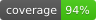

<p align="center">
  <picture>
    <source media="(prefers-color-scheme: dark)" srcset="frontend/public/logo-white.png">
    
  </picture>
</p>

# TrackIdea – radar innowacji

[](https://github.com/shirkxa/TrackIdea/actions/workflows/backend.yml)

**Narzędzie do odkrywania i analizy istniejących innowacji w Polsce.** Radar zbiera rozwiązania technologiczne,
edukacyjne i administracyjne z rozproszonych źródeł, porządkuje je w karty, ocenia poziom wdrożenia i potencjał
oraz pokazuje, gdzie mogą znaleźć zastosowanie.

Prototyp na HackNation – wyzwanie Podkarpackiego Centrum Innowacji **„Radar innowacji”**.
Plan projektu: [`docs/TrackIdea_plan_projektu.pdf`](docs/TrackIdea_plan_projektu.pdf).

> Radar nie jest platformą do zgłaszania pomysłów, portalem społecznościowym ani narzędziem do pozyskiwania
> finansowania – zgodnie z doprecyzowaniem wyzwania.

## Problem

Informacje o innowacjach są rozproszone w wielu źródłach, więc wartościowe rozwiązania pozostają mało znane,
a instytucje niezależnie budują podobne rzeczy.

## Rozwiązanie

| Etap | Co robi TrackIdea |
|---|---|
| **Wyszukaj** | Radar importuje rekordy z otwartych źródeł i przypisuje je do obszaru: technologiczny, edukacyjny lub administracyjny (definicja innowacji wg Podręcznika Oslo 2018). Każdy nowy rekord analizuje model AI (gdy jest klucz) albo zestaw reguł: czy to w ogóle innowacja, opis po polsku, sektor, etap. Rekord, który według AI nie jest innowacją, trafia do odrzuconych – analityk może go przywrócić. |
| **Uporządkuj** | Każdy rekord to karta: opis, instytucja, źródło, etap wdrożenia. Duplikaty z wielu źródeł są wykrywane. Do 4 innowacji można porównać obok siebie. Gotowe widoki dla grup odbiorców: inwestorzy, samorządy, uczelnie, szkoły, startupy, wynalazcy. |
| **Oceń** | Każda karta od razu dostaje ocenę automatyczną (szacunek) według kryteriów z FAQ: poziom wdrożenia (koncepcja → stosowane w praktyce), TRL 1–9, innowacyjność, potencjał zastosowania, wiarygodność. Automat nie udaje wiedzy, której nie ma: etap bez podstaw w źródle jest „nieustalony”, TRL liczy się tylko dla technologii, a najwyższą ocenę innowacyjności może przyznać dopiero analityk. Szacunki (także opis przygotowany przez automat) są oznaczone i odróżnione od faktów ze źródła; analityk PCI je weryfikuje. |
| **Wskaż zastosowanie** | Reguły podpowiadają, gdzie rozwiązanie może zostać użyte; zapytania „szukam rozwiązania” dostają dopasowania. |

```
Wykryta → W ocenie → Zweryfikowana        (albo: Odrzucona / Połączona)
```

## Technologie

- **backend/** – Java 21, Spring Boot 4.2, Spring Security, JPA, H2 (domyślnie) lub PostgreSQL
- **frontend/** – React 19, Vite
- Dokumentacja API: Swagger UI pod `/swagger-ui.html`; katalog można pobrać jako CSV

## Uruchomienie

Wymagania: **Java 21+** i **Node.js 20.19+**.

```bash
cd backend
./mvnw spring-boot:run
```

```bash
cd frontend
npm install
npm run dev
```

Otwórz **http://localhost:5173**. Restart backendu przywraca czyste dane demo (lokalnie baza jest w pamięci).

**Źródła Radaru.** Po starcie backend pobiera prawdziwe rekordy i odświeża je co 6 godzin:

- **OpenAlex** – publikacje polskich uczelni i instytutów; bez klucza dzienny limit jest wspólny dla adresu IP, więc
  ustaw bezpłatny klucz w zmiennej `OPENALEX_API_KEY`,
- **CORDIS** – projekty UE z udziałem polskich gmin, szkół, uczelni i firm (bez stypendiów i staży Marie Skłodowskiej-Curie
  oraz grantów ERC – to finansowanie ludzi i badań podstawowych, nie rozwiązań),
- **Fundusze Europejskie 2021–2027** (dane.gov.pl) – w tym projekty PARP i NCBR oraz programów regionalnych; Podkarpacie na początku,
- **RAD-on** (OPI PIB) – patenty i wzory użytkowe polskich uczelni i instytutów z opisem, twórcami i linkiem do karty
  w e-Wyszukiwarce Urzędu Patentowego; uczelnie z Podkarpacia na początku.

**Źródło potrzeb.** Tablica „Szukam rozwiązania” dostaje też prawdziwe zapotrzebowanie z **Biuletynu Zamówień Publicznych**
(ezamowienia.gov.pl): ogłoszenia, w których gmina, szkoła, szpital lub uczelnia chce coś wdrożyć, zbudować albo zbadać
(bez serwisu, licencji i samego sprzętu). Każda taka potrzeba ma link do ogłoszenia i termin składania ofert, po którym
znika z tablicy; innowacje są do niej dopasowywane tak samo jak do zapytań z formularza.

Analityk PCI może też dodać rekord ze **strony** (gminy, szkoły, uczelni) albo z **treści dokumentu** – Radar wyciąga
pola karty (model Claude, gdy jest klucz; bez niego reguły) i oznacza je jako szacunek. Bez internetu Radar może wczytać próbki z plików:

```bash
./mvnw spring-boot:run -Dspring-boot.run.arguments=--trackidea.radar.live=false
```

**Analiza AI.** Z ustawioną zmienną `ANTHROPIC_API_KEY` każdy nowy rekord z Radaru analizuje model Claude
(`trackidea.ai.model`, domyślnie `claude-opus-5-5`): werdykt „innowacja / nie / niepewne” z uzasadnieniem, tytuł i opis
po polsku (także dla rekordów po angielsku), obszar, sektor, etap wdrożenia, TRL i nowość. Bez klucza Radar używa reguł
słownikowych – działają offline, ale nie odrzucają rekordów i nie tłumaczą opisów. Koszt jest ograniczony: wynik analizy
jest zapamiętywany na dysku (`trackidea.ai.cache-dir`), a jeden skan analizuje najwyżej `trackidea.ai.import-limit`
(domyślnie 60) nowych rekordów; pozostałe dostają reguły. Analizę przy imporcie wyłącza `trackidea.ai.import-enabled=false`.

Katalog jest publiczny. **Logowanie** potrzebne jest tylko zespołowi PCI do weryfikacji i oceny:
`k.nowak@pci.example.org`, hasło `demo123` (w trybie demo konto można też przełączyć w prawym górnym rogu).

**Produkcja** (profil `prod`, domyślny w obrazie Dockera):

| Zmienna | Znaczenie |
|---|---|
| `TRACKIDEA_PASSWORD` | Hasło kont zespołu PCI. Bez niej przy pierwszym starcie powstaje losowe hasło wypisane w logu. |
| `TRACKIDEA_DEMO_MODE` | `true` włącza przełączanie kont bez hasła – tylko świadomie, na czas prezentacji. Domyślnie `false`. |
| `TRACKIDEA_DATA_DIR` | Katalog bazy (plik H2), pamięci analiz AI i pobranych plików; w Dockerze `/data` – podłącz tam wolumen. |
| `TRACKIDEA_DEMO_DATA` | `false` pomija fikcyjne karty przykładowe; katalog wypełnia wtedy sam Radar. |
| `ANTHROPIC_API_KEY`, `OPENALEX_API_KEY` | Klucze analizy AI i źródła OpenAlex. |

Z PostgreSQL: `SPRING_PROFILES_ACTIVE=prod,postgres` oraz `DATABASE_URL`, `DATABASE_USER`, `DATABASE_PASSWORD`.

## Testy

```bash
cd backend
./mvnw test
```

161 testów (JUnit 5), pokrycie linii 94% (gałęzi 82%):

- **jednostkowe** – wzór oceny i wagi, podobieństwo tekstów po polsku, reguły dopasowań i rekomendacji zastosowań,
  analiza tekstu offline, importery wszystkich źródeł Radaru (OpenAlex, CORDIS, Fundusze Europejskie z plikiem XLSX,
  RAD-on, BZP) na przygotowanych odpowiedziach API, pobieranie i wznawianie plików, ochrona przed adresami
  wewnętrznymi, skala TRL i obszary;
- **na kontekście aplikacji z danymi demo** – skan Radaru (nowa karta, odświeżenie, duplikat, błąd źródła), potrzeby
  ze źródeł, poprawki karty i zatwierdzanie oceny przez analityka, mierniki panelu PCI oraz endpointy REST: katalog
  z filtrami i eksportem CSV, karta innowacji, tablica potrzeb, słowniki, logowanie, CSRF i uprawnienia zespołu PCI.

Osobne testy sprawdzają analizę AI przy imporcie na podstawionym modelu (opis po polsku, automatyczne odrzucenie
i przywrócenie rekordu, limit na skan, pamięć wyników) oraz profil produkcyjny (brak logowania bez hasła, baza na dysku).

Testy nie łączą się z internetem. Raport pokrycia (JaCoCo) powstaje przy każdym przebiegu w
`backend/target/site/jacoco/index.html`. Odznakę na górze README generuje z niego skrypt:

```bash
./coverage-badge.sh
```

W CI odznaka jest odświeżana automatycznie po zmianie na `main` (commit bota tylko wtedy, gdy procent się zmienił),
a raport HTML jest dołączany do przebiegu jako artefakt `jacoco-report`.

## Dane, bezpieczeństwo i ograniczenia

- **Dane:** OpenAlex, CORDIS, dane.gov.pl, RAD-on i BZP przez otwarte API (bez kluczy); kolejne źródła dodaje się jako nowy importer
  (`SourceImporter` dla innowacji, `NeedSource` dla potrzeb). OpenAlex bez klucza ma wspólny dzienny limit zapytań na adres IP –
  po jego wyczerpaniu źródło wraca następnego dnia. Strony wskazane przez analityka są pobierane tylko z publicznych adresów http/https.
- **Ocena:** jawne reguły i wagi; AI i reguły tylko proponują, decyzję zatwierdza ekspert PCI. Automatyczne odrzucenie
  rekordu przez AI jest odwracalne – takie rekordy mają osobną kolejkę w panelu PCI.
- **Dane przykładowe:** karty ze źródłem „Przykład (dane demo)” i patenty „do porównań” są fikcyjne; panel PCI podaje,
  ile ich jest i że mierniki weryfikacji są na razie liczone na nich.
- **Ograniczenia:** bez klucza AI opisy rekordów zagranicznych zostają po angielsku, a wyszukiwarka nie łączy języków;
  katalog i dopasowania są liczone w pamięci (wystarcza na tysiące rekordów, nie na setki tysięcy).
- **Prywatność:** Radar nie zbiera danych osobowych użytkowników; autorzy innowacji są podawani tak, jak w źródle.
- **Bezpieczeństwo:** logowanie Spring Security (sesja HttpOnly, CSRF, hasła BCrypt), uprawnienia sprawdzane
  w backendzie. Tryb demo służy tylko prezentacji – profil `prod` ma go wyłączonego i nie używa hasła demo.
